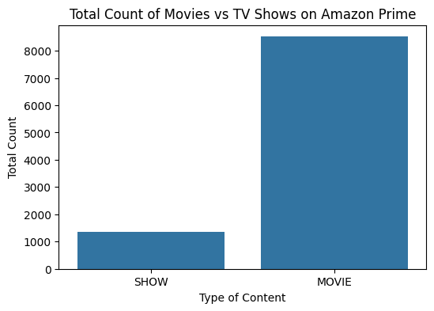
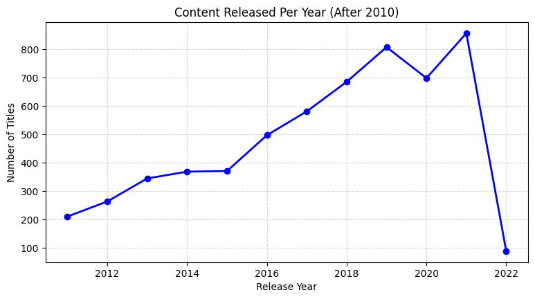
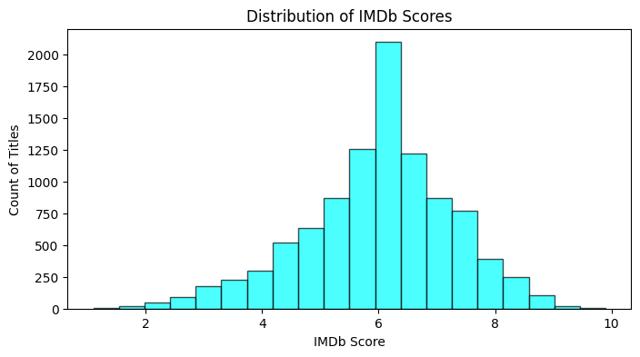
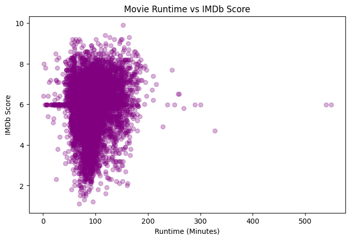
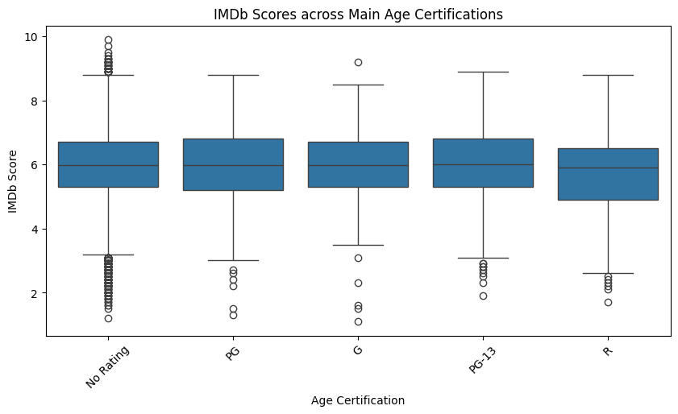

# Amazon Prime Video TV Shows and Movies EDA

An AlmaBetter pandas and NumPy module project. Exploratory data analysis of Amazon Prime Video's US catalog to understand how the library is built, how it grew, and what does (and does not) relate to audience ratings.

[Open the notebook in Colab](https://colab.research.google.com/github/pranatipradhanwork-alt/amazon_tvshows_movies_EDA/blob/main/amazon_project.ipynb)

## Data

Two tables joined on the title `id`:

| File | Rows | Contents |
|---|---|---|
| `titles.csv` | 9,871 | One row per movie or show: type, release year, runtime, genres, age certification, IMDb score |
| `credits.csv` | 124,235 | Actors and directors linked to each title |

**Cleaning:** missing age certifications filled with "No Rating", missing genres with "Unknown", and missing IMDb scores and runtimes with the column mean.

## Questions and assumptions tested

1. Are there far more movies than TV shows?
2. Did the catalog grow quickly after 2015, during the "streaming wars"?
3. Does a movie's runtime affect its IMDb score?
4. Do mature-rated titles (e.g. R) get higher, steadier scores?

## Findings

**1. Movies dominate the catalog: 86% movies, 14% shows.** Assumption 1 confirmed. Movies build catalog size quickly and cheaply compared with multi-season series.

**2. Releases climb sharply after 2015.** Assumption 2 confirmed, matching the period when streaming competition intensified.

**3. Most titles are mid-rated.** IMDb scores form a bell curve centred around 6.0 to 6.5, so the library is mostly average, middle-tier content with a few highly rated titles.

**4. Runtime barely relates to rating (r = 0.12).** A weak positive correlation: most movies run 80 to 120 minutes, and highly rated movies appear at every length. Assumption 3 confirmed: length alone does not drive ratings.

**5. Mature ratings do not score higher.** Among the five most common certifications, medians are similar (about 6.0), and R-rated titles have the lowest median (about 5.9) and a wider lower spread. Assumption 4 is not supported.

**Talent:** after merging the two tables, the most frequent actors are George "Gabby" Hayes (49 titles), Roy Rogers (45) and Bess Flowers (44), which points to a large back catalog of classic films.

## Recommendations

- **Invest more in episodic TV shows.** Movies dominate the catalog, but series bring viewers back season after season, which supports retention.
- **Prioritise quality over volume.** Most of the catalog sits around an average score, so curating stronger titles matters more than adding more of them.
- **Do not use runtime or age rating as a proxy for quality** when choosing content to acquire; neither shows a strong link to audience scores.

## Tools

Python, pandas, NumPy, Matplotlib, Seaborn, Google Colab.

## Author

Pranati Pradhan · [GitHub](https://github.com/pranatipradhanwork-alt) · [LinkedIn](https://www.linkedin.com/in/pranati-pradhan-work)
